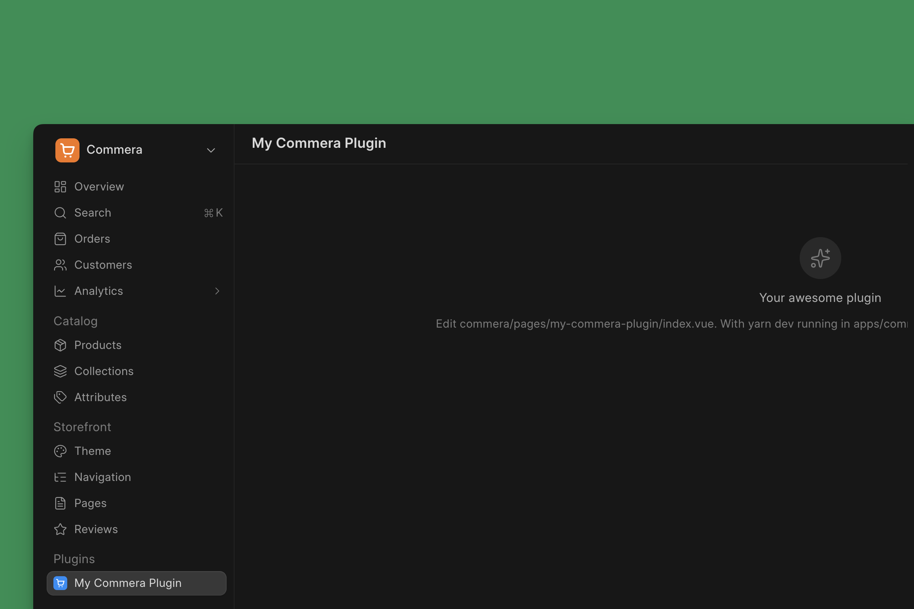
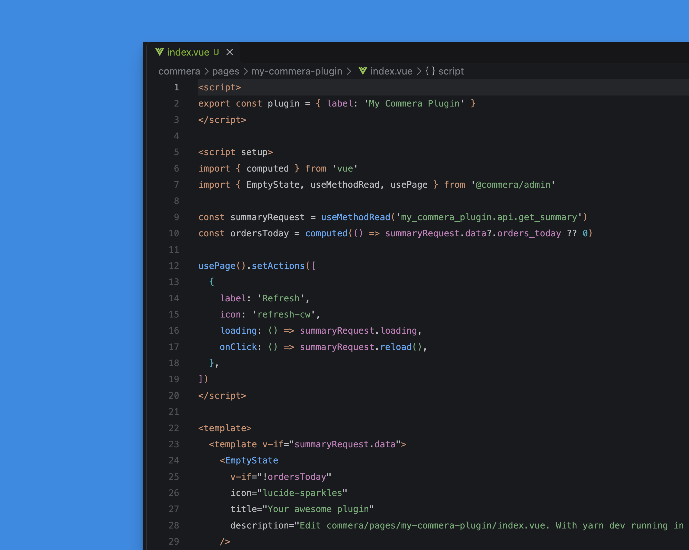
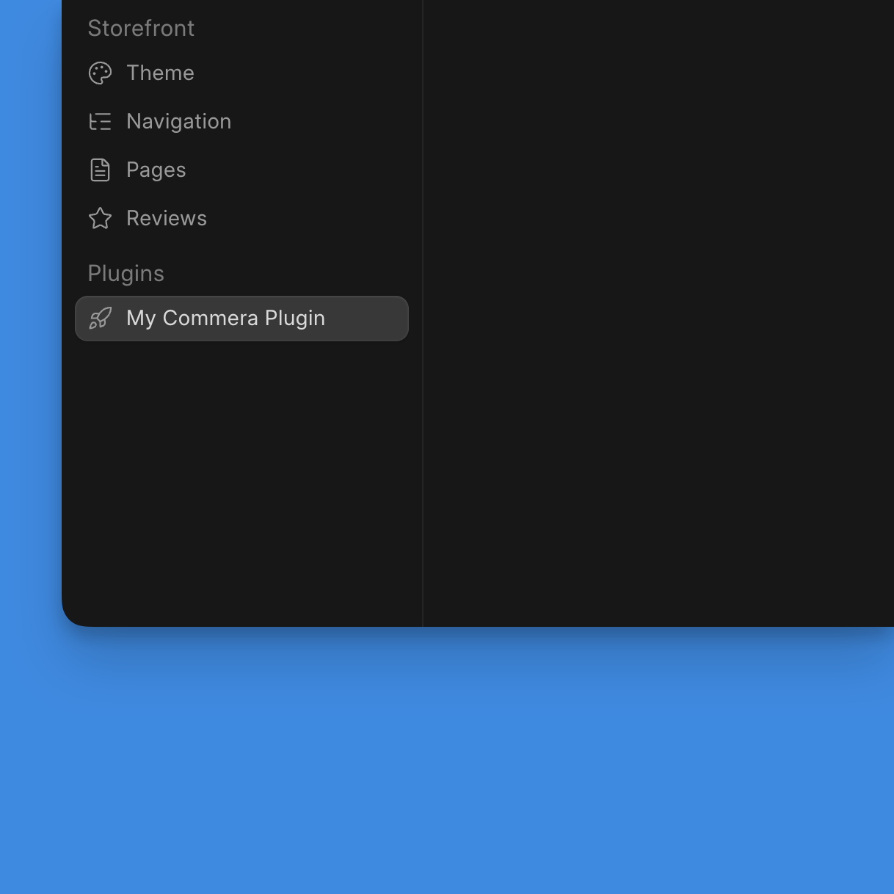
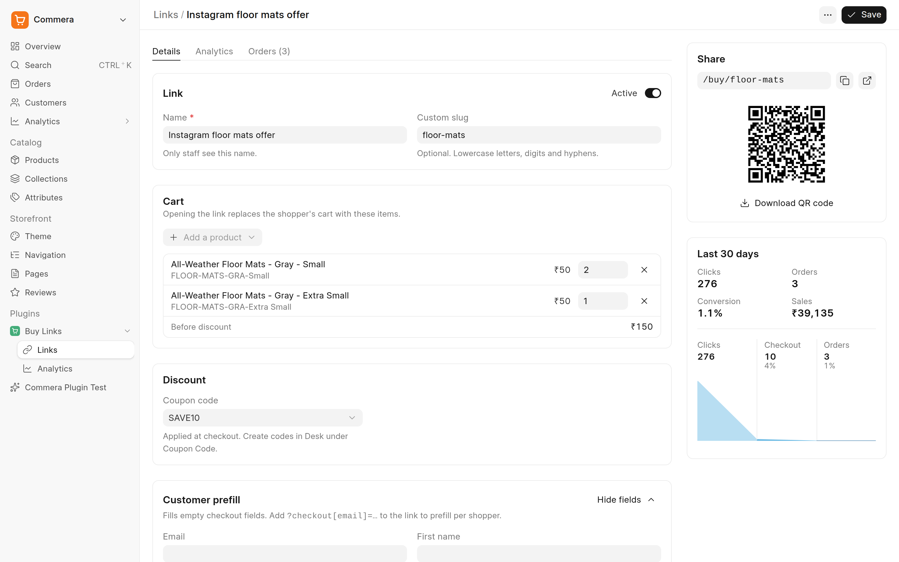
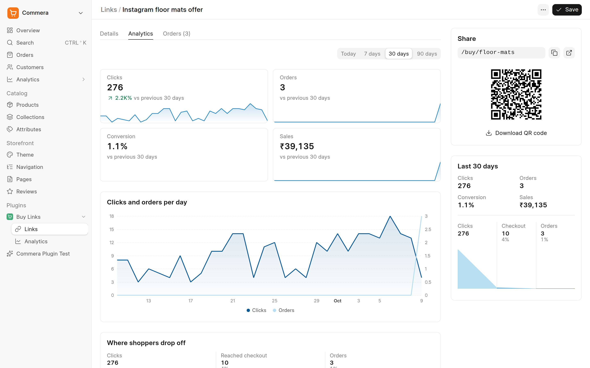
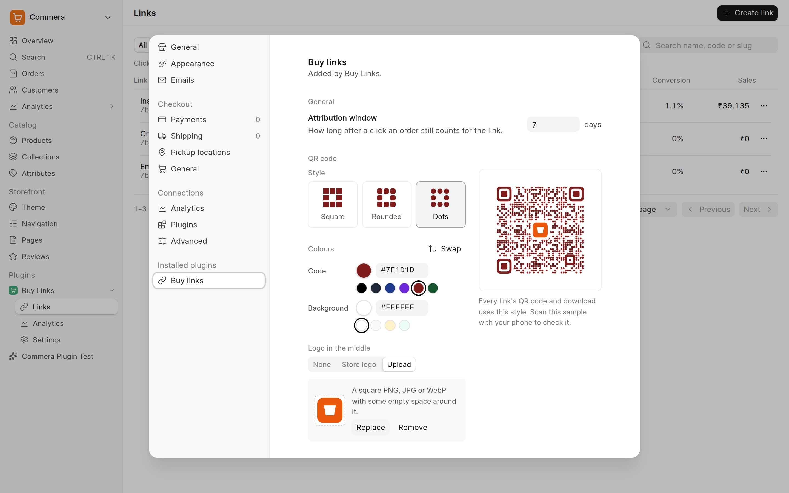

We recently shipped a robust plugin system in [Commera](https://commera.app), our open-source eCommerce platform backed by ERPNext.

## What is a Commera Plugin?

As we mentioned in the [Commera announcement blog post](/blog/announcements/commera-now-in-beta), to take on Shopify, we need a solid app ecosystem. Commera plugins are actually custom Frappe apps with a special setup. Since Frappe Framework already calls them apps, we decided to call them plugins to avoid confusion.

### Creating a Commera Plugin

To create a Commera plugin, create a new custom Frappe app and then run this command inside the app:

```bash
$ bench new-app my_commera_plugin
$ cd apps/my_commera_plugin
$ bench commera init
```

The above sets up all the necessary boilerplate (inside a directory named `commera`) and config files so that this app is picked up by Commera as a plugin. If you now install this app on a site that has Commera and start your Yarn development server (run `yarn dev` inside the Commera app), the plugin should immediately appear in the merchant dashboard:



Here is what the folder structure looks like:

```text
commera/
├── commands/
├── customer/
│   ├── actions/
│   └── cards/
├── order/
│   ├── actions/
│   └── cards/
├── pages/
│   └── my_commera_plugin/index.vue
├── product/
│   ├── actions/
│   └── cards/
├── settings/
├── shared/
└── plugin.config.ts
```

If you open the `index.vue` of the default page, you will see some starter code:



If you change something, it should hot reload. You can import anything from `frappe-ui` and use it directly. I will change the sidebar link icon by passing in a Lucide icon name:

```
export const plugin = { label: 'My Commera Plugin', icon: 'rocket' }
```

The icon will change:



### What can a Plugin do?

A lot of things. For starters, you can create complete [Frappe UI](https://ui.frappe.io) based apps inside the Commera dashboard using the pages feature. You can also:
* hook into the existing UI: custom actions on customers, orders, etc.
* embed custom cards in pages like Customer details
* add custom actions to the command bar (search) menu
* add your own settings page, and more.

Most of the above works by convention, i.e. write your code in a specific directory or file and it gets picked up. But you as a developer (or agent) shouldn't have to create these boilerplate starter files on your own, so we have provided a nice CLI experience:

```bash
bench commera add page # create a new empty page
bench commera add settings # add a settings page
bench commera add customer-action # add a custom action to customer details
```

In the backend, apart from Frappe's own hooks, we have our own hooks:

```py
commera_events = {"order_paid": ["my_app.orders.on_order_paid"]}

commera_hooks = {"validate_cart": ["my_app.cart.get_cart_refusal"]}
```

You can also customise your plugin image and add custom actions to the sidebar (using `plugin.config.ts`). You can find the complete reference on what is available and on building plugins [here](https://docs.bwh.tech/commera/build-a-plugin/overview). The docs also have a detailed tutorial on building a production plugin from scratch that interacts with a third-party drop-shipping service.

Although you can use any of the Frappe APIs in your plugin (remember, in the end it is just a custom Frappe app with a special frontend structure), we have provided a stable [SDK](https://docs.bwh.tech/commera/plugin-reference/sdk) that you can use in your server-side code.

## How was it built?

Now coming to building the plugin system itself. This started with [me spec-ing out a system design](https://github.com/bwhtech/commera/pull/168) with my AI agent. Then Rahul [took over](https://github.com/bwhtech/commera/pull/201) and made it production-ready.

The goal was clear from the start: the plugin system should be flexible and powerful enough that developers can build useful plugins as per their requirements. And what better way to test a plugin system than to create a plugin? I **picked up an award-winning Shopify app and tried to port it to Commera as a plugin**: [Checkout Links](https://apps.shopify.com/checkoutlinks). As I tried to build this plugin, we identified a lot of gaps and fixed them in the plugin system. After a few iterations, we were able to build the Checkout Links plugin without any hacks! You can find the source code of this plugin [here](https://github.com/bwhtech/commera_buy_links).

Here are some screenshots of the plugin in action:







## Next Steps

We are well aware that agents will be the primary developers of new plugins, so we are going to ship a SKILL with the stable release, along with the revamped theme development system.

The plugin system should *not only* be one unified way to extend Commera with new features like Loyalty, etc., but it should also be the way to add integrations like payment and shipping. Right now, `bwh_payments` and `bwh_shipping` are mandatory apps required before you can install Commera, which is a big source of friction in our opinion. To fix this, we will be **moving core payments and shipping integrations to Commera core and then extending the plugin system to support Payment and Shipping plugins**.

I would encourage you to try building a plugin for your own needs. If you find any hook or extension point missing, just let us know by creating a GitHub issue [here](https://github.com/bwhtech/commera/issues/new).
