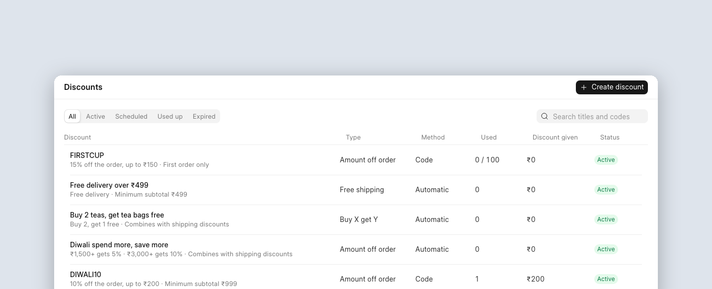
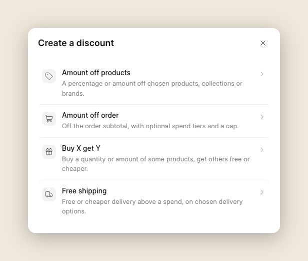
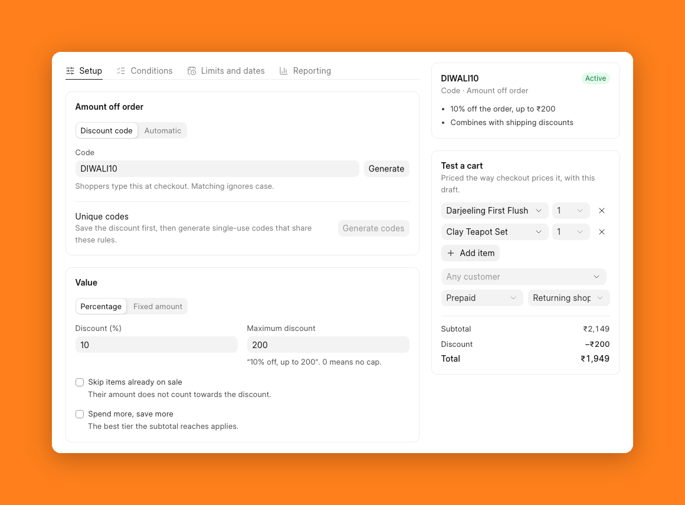
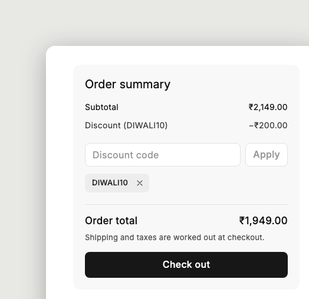
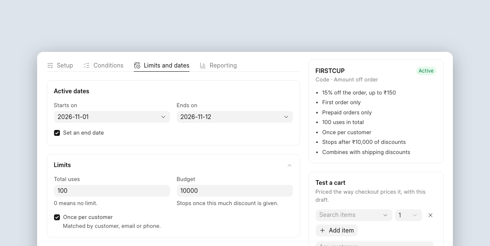
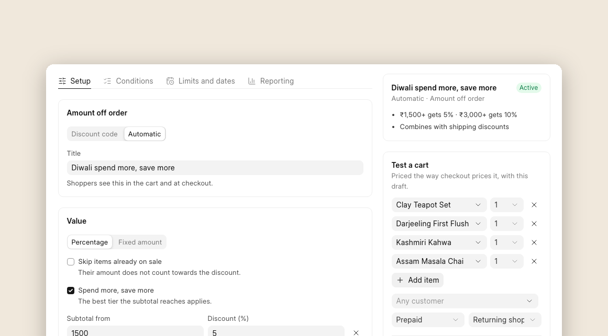
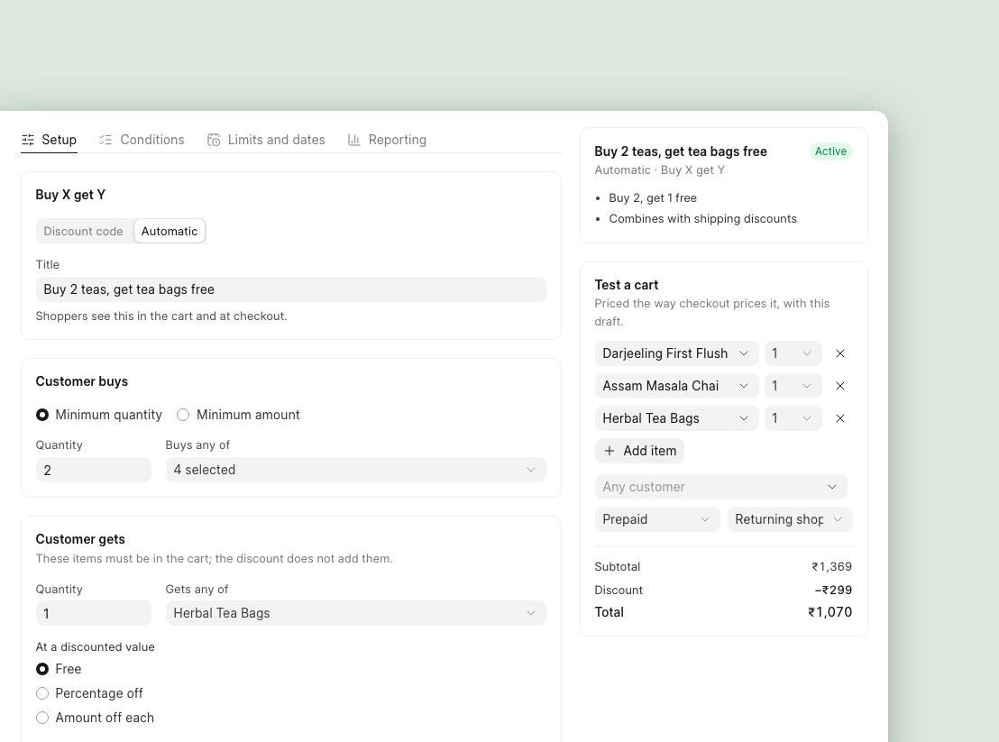
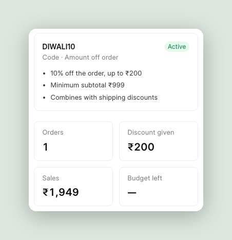

For quite a while I was delaying coupons. There are just too many cases: percentage or flat, one product or the whole order, two codes together, cash on delivery, cancelled orders, and so on. Then one day Hussain decided enough is enough and built a POC for coupons. We picked it up from there, and now Commera has proper Shopify-style discounts. Here is how it works.

## Why not ERPNext coupons?

ERPNext already has Coupon Codes and Pricing Rules, so we tried those first. They are fine for simple discounts, but they break when you want something a little more complex:

- You can apply only one coupon to an order.
- If two coupon rules match the same item, ERPNext can't decide which one to use, and the cart fails.
- A coupon rule can remove an automatic discount on the same item, even when the shopper never used that coupon.

So we keep Commera discounts separate from ERPNext's pricing rules. The final discount still goes into ERPNext's normal discount fields, so your Sales Order, Sales Invoice and accounting stay the same as before.

## What you can create

Open **Discounts** in the merchant dashboard. Here you can see all your discounts, whether they're active, and how many times each one was used.

There are four types:

- **Amount off products**: money off selected products, collections or brands.
- **Amount off order**: money off the whole cart.
- **Buy X get Y**: for example, buy 2 teas and get the tea bags free.
- **Free shipping**: free or cheaper delivery above an amount.

A discount can be a **code** the shopper types in, or **automatic**, where it just applies when the cart qualifies.

Here is a typical festival code: 10% off, up to ₹200. The **Test a cart** box on the right lets you try it with real products before you share the code.

And this is what the shopper sees in the cart:

## Comes with guard rails

You don't want a discount to cost you more than you planned, so we added a few guard rails:

- **A cap on percentage discounts**: "10% off, up to ₹200", so a big order doesn't get a huge discount.
- **Prepaid only or cash on delivery only**: give a little extra to shoppers who pay online.
- **Skip items already on sale**: so sale items don't get discounted twice.
- **A budget**: the discount stops after it has given away, say, ₹10,000.
- **Dates and limits**: a start and end date, a total number of uses, once per customer, and first order only.

You can also reward bigger carts with spend tiers, for example 5% off above ₹1,500 and 10% off above ₹3,000:

You choose which discounts can be used together, and a cart can have up to five codes. For an influencer campaign, you can generate up to 5,000 single-use codes at once, all with the same rules.

## How it works

Now a little bit of the technical side.

Whenever ERPNext saves a Quotation, Sales Order or Sales Invoice, Commera does three things:

1. Removes the discount it added last time.
2. Lets ERPNext calculate the price as usual, with price lists, pricing rules and taxes.
3. Calculates the discounts again and adds them back.

So ERPNext still decides the price, and our discount always comes on top. Nothing gets counted twice, and an ERPNext pricing rule can't wipe out a Commera discount.

We also moved the cart to the server. Before, it was mostly in the browser. Now the cart is a real record, so the discount the shopper sees in the cart is exactly what they get at checkout. Plugins can also create a cart or add extra details to its items.

When an order is placed, Commera saves a row for each discount used on it.

One thing we did on purpose: once a code is used on an order, it counts, even if the order gets cancelled later. Otherwise someone could keep reusing a "once per customer" code just by placing and cancelling orders.

## For plugin developers

Plugins can work with discounts too:

- `cart_discounts`: take an amount off an item or the whole order.
- `validate_discount_code`: refuse a code with your own message, for example "This code is only for members".
- `discount_used`: an event you can listen to when an order uses a discount.

The SDK also has a new `discounts` module. See the [plugin reference](https://docs.bwh.tech/commera/plugin-reference/hooks).

## Try it

Discounts are live in Commera. To set them up step by step, follow the [Discounts guide](https://docs.bwh.tech/commera/discounts/discounts-overview). If your store needs a discount we don't support yet, tell us on [GitHub](https://github.com/bwhtech/commera/issues) or in the Telegram group.
