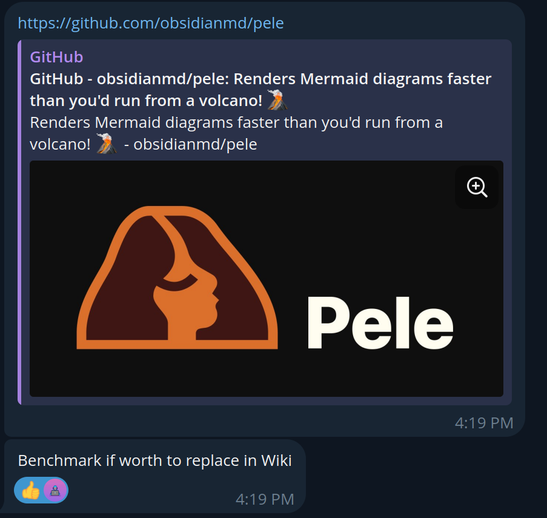
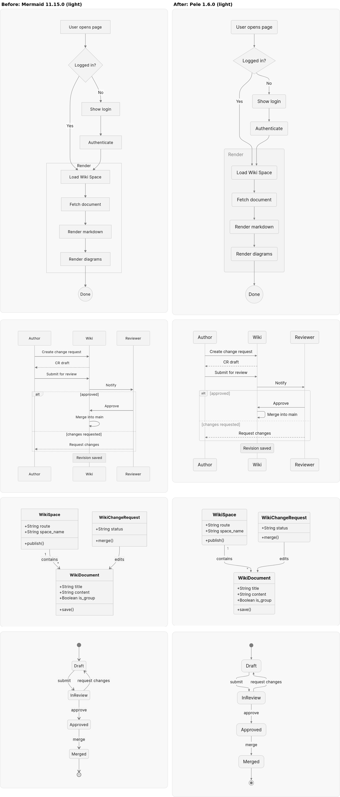
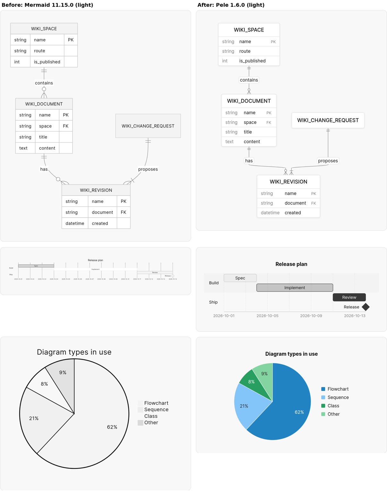
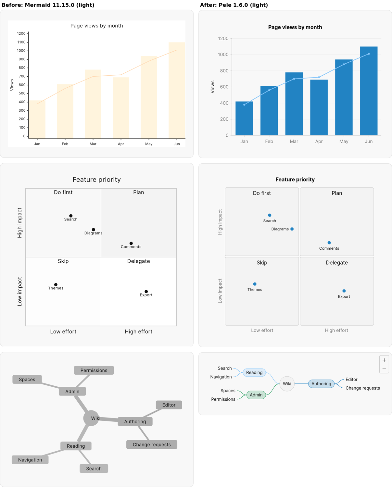
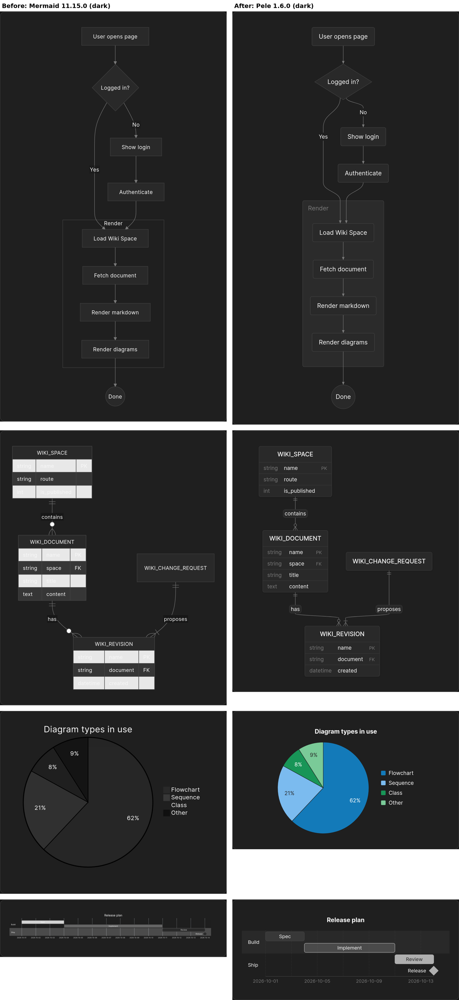
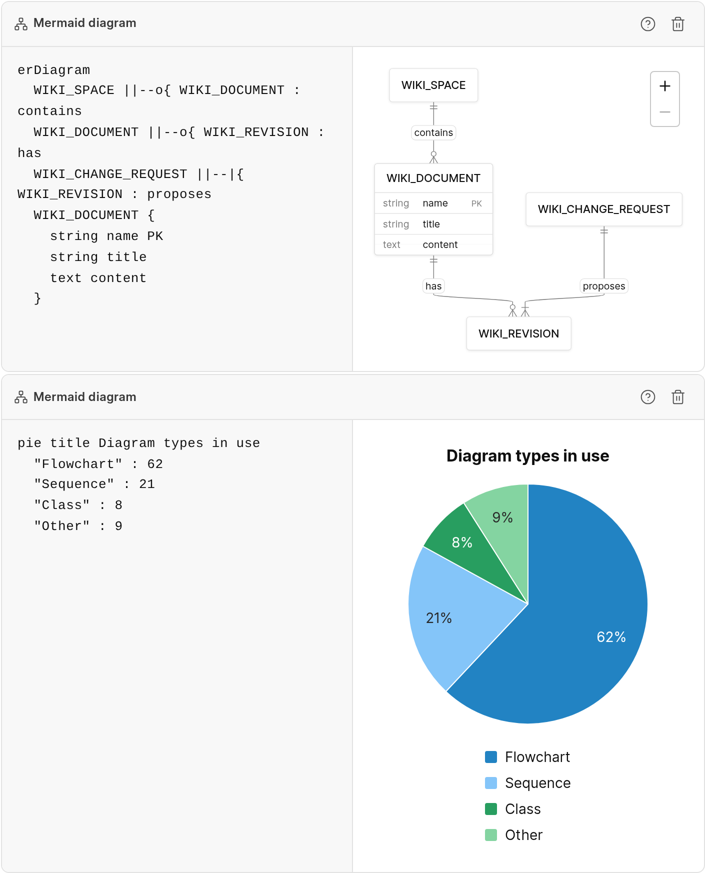
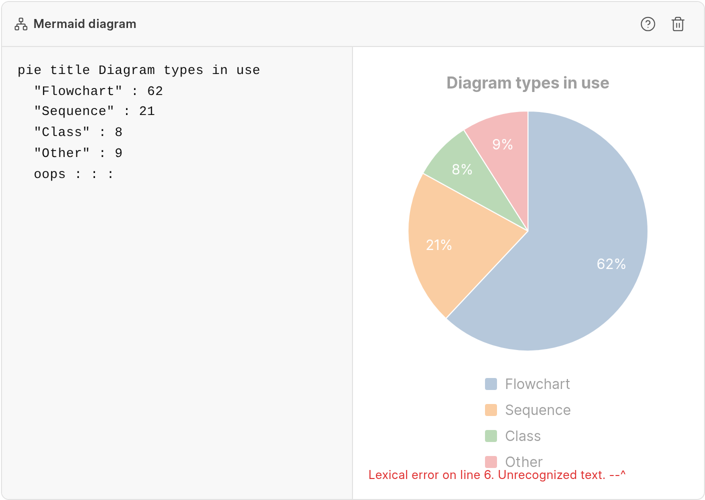

Boss sent me a link to [Pele](https://github.com/obsidianmd/pele), a new diagram renderer from the Obsidian team.

<figure style="max-width:600px; margin:1.5em auto;">

</figure>

So I did. I ran both renderers on a real wiki page, checked every example in Mermaid's docs, and compared the numbers. It turned out to be worth it, and we recently replaced Mermaid with Pele in Frappe Wiki.

## Why replace Mermaid?

Mermaid is powerful, but it is heavy. It ships around 904 KB gzipped and gets noticeably slower on pages with many diagrams.

Making it match our theme was also hard. We had to write extra code just to pass our colors and fonts to Mermaid. And every time you switched to dark mode, every diagram on the page had to be drawn again.

## Why Pele?

Pele is an open-source diagram renderer from the Obsidian team. And don't worry, your existing Mermaid diagrams won't break 😅

Pele understands the same Mermaid syntax, so everything keeps working as before. How you write a diagram and how the wiki stores it did not change.

It is also much lighter, just 252 KB gzipped, and it renders diagrams almost instantly.

## A taste of the Frappe ecosystem

One thing I really liked about Pele is that it takes its colors straight from CSS.

That made it easy to style everything with Frappe UI tokens:

- Pie and XY charts use the same colors as frappe-ui charts.
- ER diagrams look like the table cards in Frappe Insights.

Dark mode is handled entirely in CSS, so no diagram has to be redrawn when you switch themes.

The editor uses the same renderer, so the preview matches what readers see. If you make a typo, the last good diagram stays on screen, dimmed, with the error below it.

<figure style="max-width:705px; margin:1.5em auto;">

</figure>

<figure style="max-width:705px; margin:1.5em auto;">

</figure>

## The benchmark

We measured a real wiki page with 12 diagrams in Chrome, taking the median of 5 cold loads.

| | Mermaid | Pele |
|---|---|---|
| Load until all diagrams are drawn | 839 ms | 410 ms |
| Main thread blocked on load | 464 ms | 42 ms |
| Theme switch | 351 ms | 29 ms |
| Editor keystroke | 39 ms | 1 ms |
| 100-node flowchart | 285 ms | 20 ms |
| Memory (JS heap) | 13.5 MB | 5.9 MB |

On a slow computer, the page load drops from 3,071 ms to 1,040 ms, and a theme switch drops from 1,435 ms to 40 ms.

Pele rendered all 548 examples from Mermaid's own documentation that Mermaid itself renders, with zero regressions.

Sometimes the best optimization is removing the thing that was making everything harder.

So, Boss: yes, it was worth it.

Thanks to the Obsidian team for open-sourcing Pele ✌️

PR: [frappe/wiki#883](https://github.com/frappe/wiki/pull/883)
