It has been one hell of a ride! It has been 500 days since [my first post on BWH Studios](/blog/introducing-bwh-studios).

Delivering projects, travelling together, "Chai" breaks, organising a hackathon, celebrating small milestones, and even starting a school! Don't miss the gallery at the [end of this post](#bts-gallery).

Let me take you through the voyage.

## Setting sail

After my initial announcement, we started getting a lot of leads and a few converted very quickly. Initially, the majority of the projects were consulting, as in, me getting on calls or doing PoCs to help Frappe development teams in various organisations. 

As for Frappe (as a client), we started by taking up Print Designer customer support, then we collaborated on Frappe Framework support, FC Marketplace, then Wiki, and Buzz too. We also helped with Framework certifications on Frappe School. A **solid** collaboration.

## Maiden voyage

Within a few months, we went live with our very first project and Rahul [gave a talk about it at Frappeverse](https://youtu.be/VOMLprnBJyI?si=qDWF2fPHaQLvfJJF) in September of 2025:

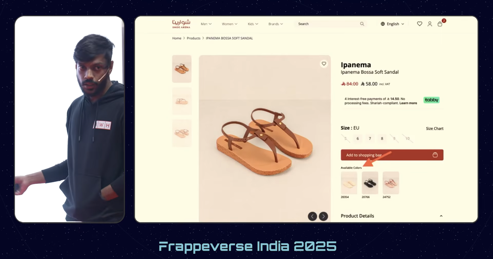

This was an e-commerce project and this has very much decided our product trajectory as you will soon see. 

## Learning the ropes

While we implemented our first projects and started dealing with a variety of leads and customers, I learned a lot about running a business, especially providing good services. 

More than what to do, I found what not to do more important: Scope creep is real, so we decided to stay away from scoped projects as much as possible and focused on retainers. The other option is to spend a lot of time scoping things down. I even picked up small things like: 

* 40% advance, 60% after go-live. Noob mistake. Then Faraz (Frappe) helped me set up a better payment terms template that motivates customers to go live.
* In one random Frappe office visit, Rushabh taught me about BANT, that changed my view on leads and sales 😭
* Fewer DMs to devs, more group convo! This brings more accountability for both sides.

... and a lot of other practical "gyan" which I won't delve into now.

We shamelessly copy-pasted a lot of things from Frappe: weekly all-hands, open days, quarterly review processes, SOPs, and much more. Of course including transparency in pay and some democratic decision-making practices.

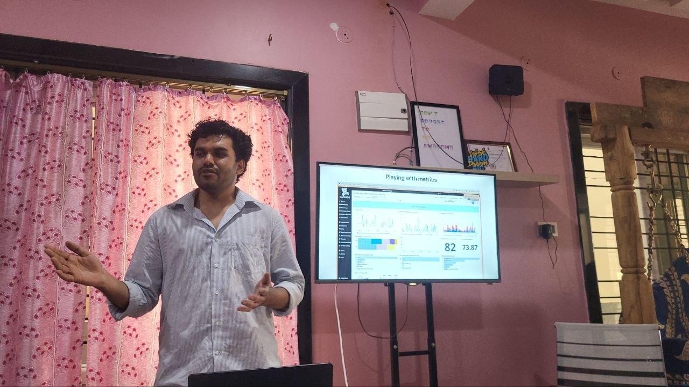

### Changing course

I was spending so much time on consulting calls and I was unable to focus on the bigger things like hiring, training, and culture. As Umair says, I was working "in" the business instead of working "on" the business.

So I decided to wind it down and stopped selling my hours for revenue. Thankfully, we onboarded a few development retainer clients around that time. We also converted a few small scoped projects for NPOs via [OASIS](https://www.oasishq.org/), which we used as *training projects for new engineers* (e.g. Vishwajeet helped ILF build their scholarship platform, Kaushal helped Kisan Swaraj with a customised [Buzz](https://buzz.events) setup).

We got to work with brands like Gaia, AevyTV, and Dhwani RIS. We quickly projected $100K "ARR". Things were going super smooth; I even gave a talk about it at Frappe Local Hyderabad.

I was also invited to [the Frappe Podcast](https://youtu.be/-6wHuM7gg_o) right after Frappeverse 2025:

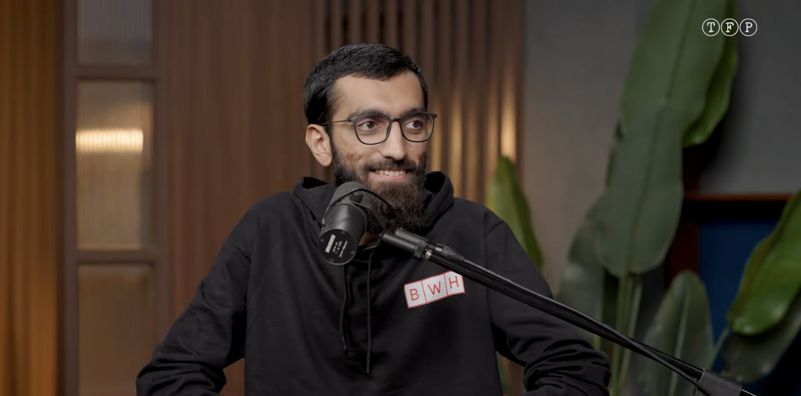

### The crew

The most important part of a business: people. We grew from 4 to 8 full-time members with Kaushal, Harsh, Gajendra, and Jatin boarding the ship along the way.

We also onboarded [Donna](https://youtu.be/BJwmotGw028?si=CLKP8ctEhp8YSgxA) in the accounts team 😉 

Honestly, this has been the best part of building BWH. *Assembling Avengers* so we can solve problems together. Chai breaks in the evening. Travelling to conferences together. 

Watching people grow is magical. I still remember when Vishwajeet joined us as an intern. He has since then become a competent Frappe developer: shipped projects end-to-end for ILF and AevyTV and also done a lot of PRs across Frappe repos. Kaushal went from 1 PR after 2 months of joining to becoming a top monthly contributor to Frappe Framework. Shivam became a developer along with being a certified consultant. Gajendra built the quiz app that powered the Frappeverse Trivia competition.

<Gallery label="The crew" autoplay>

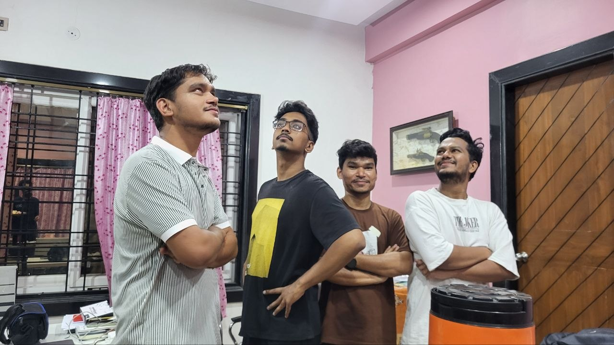

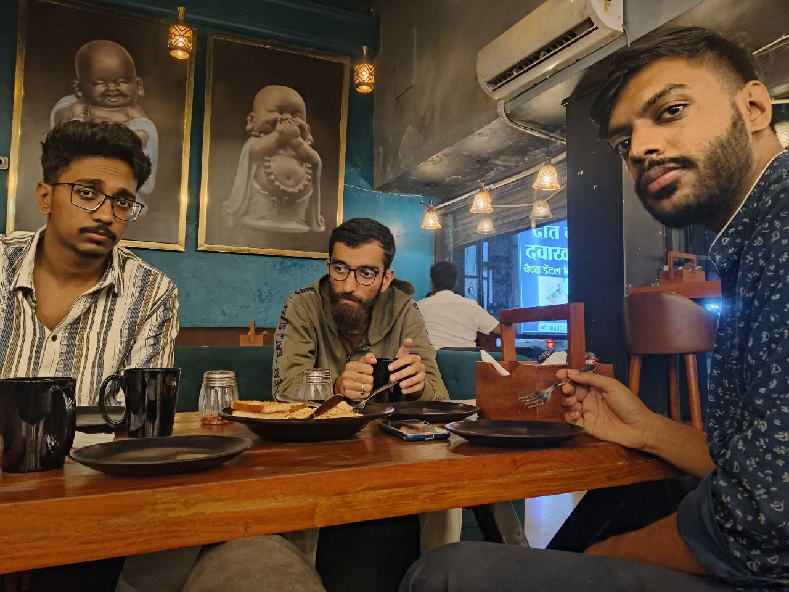

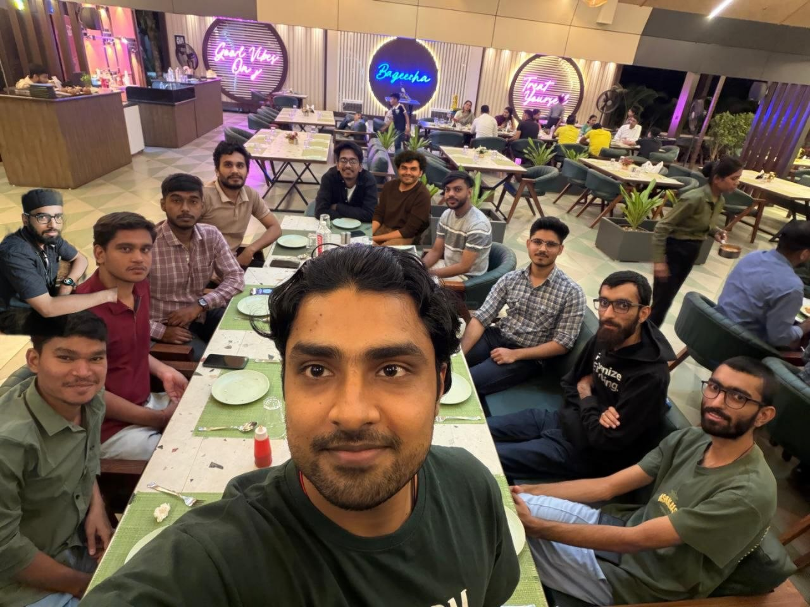

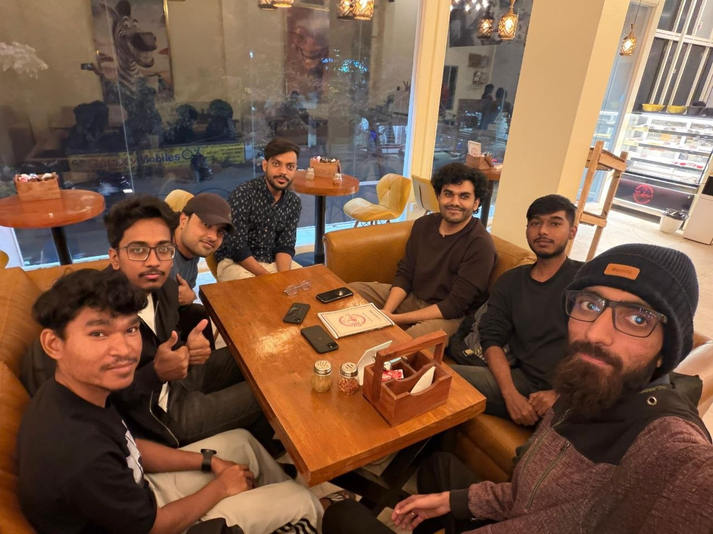

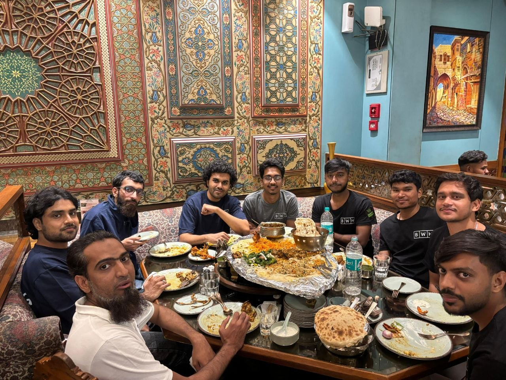

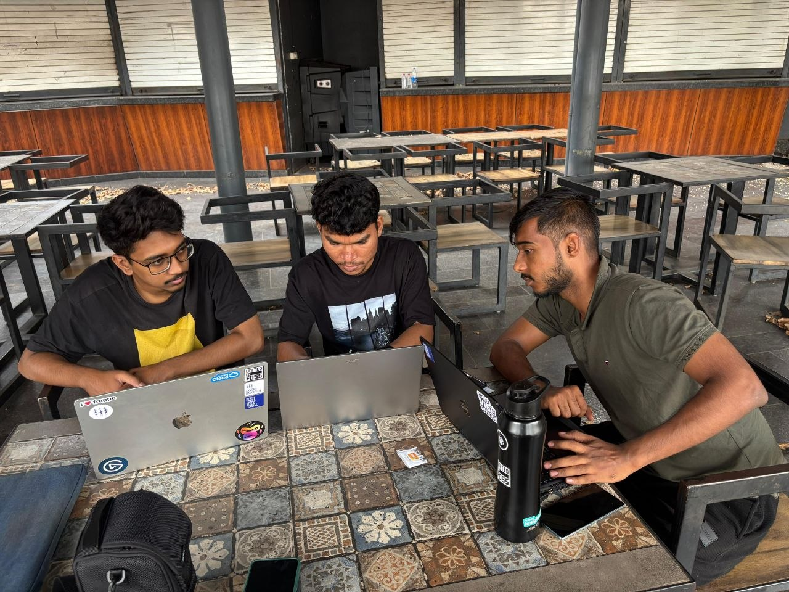

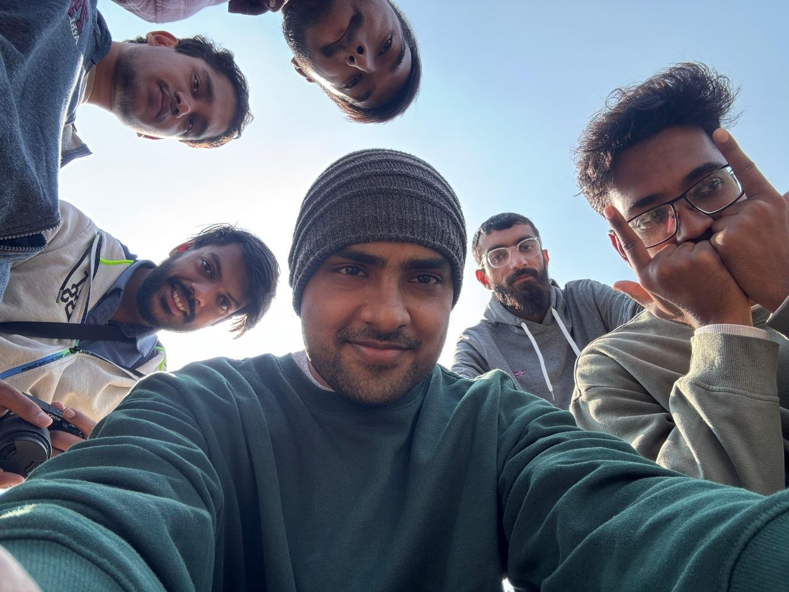

</Gallery>

We grew together.

### CS17 

We collaborated with Azim Premji Foundation to start a School of Programming at Jagdalpur. *This is something bigger than just BWH*. This is what we picked up to do some good for society and my urge to teach CS.

<Gallery label="CS17" autoplay>

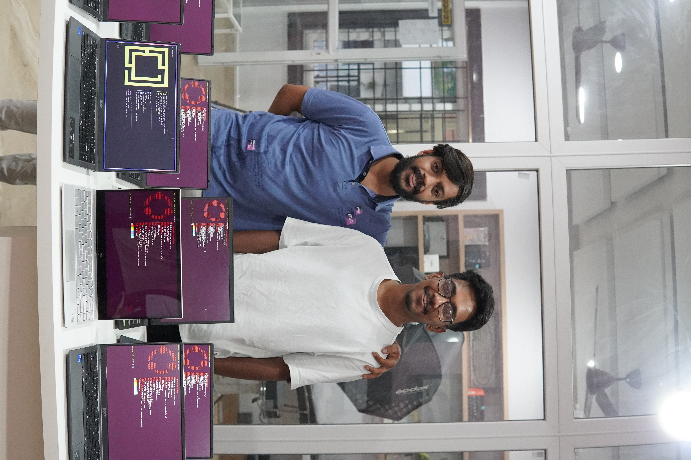

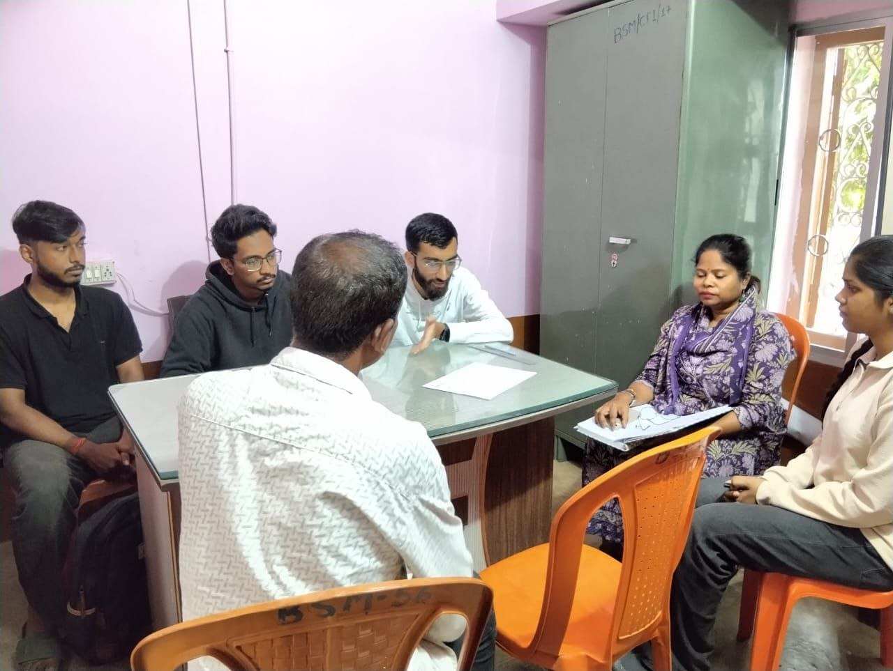

</Gallery>

This is an entire multi-blog series of its own, you can check that out [here](https://cs17.org/blog/).

### Same ship, new name

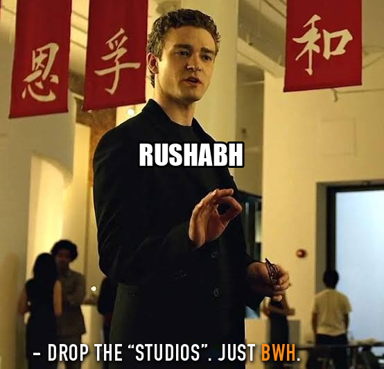

This was a welcome change. After a suggestion from Rushabh and some deliberation, we decided to rename the company to BWH (Technologies). 

Reason?

1. "Studios" made it sound like we are a recording studio or something.
2. Small agencies use "Studio" and we wanted to do products (more on this soon), the name should be trustworthy and not give a "small agency" vibe.

### Products

I started building [Buzz](https://buzz.events) (live) for Frappe, which we turned into a BWH product. Later, Harsh took over Buzz. We built Frappe Wiki v3 from the ground up.

Our first project was an e-commerce site on top of ERPNext. We got another one (even bigger) after Rahul's talk at Frappeverse, and we used the same base. A few months ago, we decided to pursue it seriously and [Commera](https://bwh.tech/blog/announcements/commera-now-in-beta/) was born.

All FOSS, of course!

### Media

Amidst all this chaos, I still continued producing content on YouTube and conducting trainings infrequently. YouTube subscribers grew from 7k to 11k! With our first hard-earned profits, we had invested a few lakh rupees in a better studio setup, which paid off in terms of production quality. 

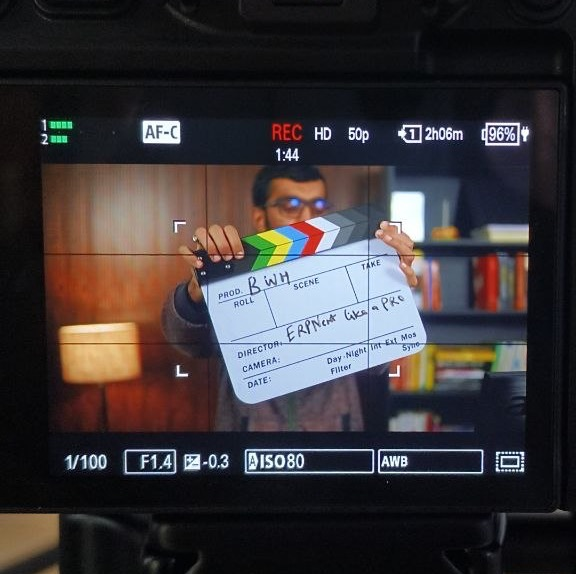

Alyf even sponsored us to kick-start a new app review series a few months ago, which was a first.

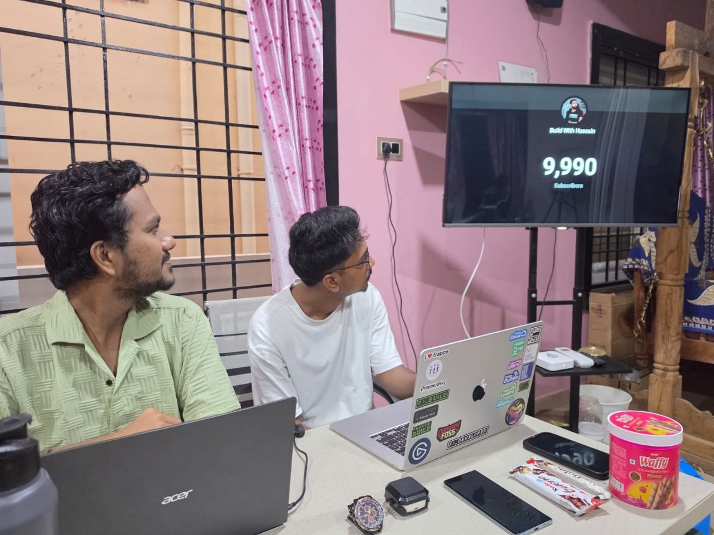

Definitely wanted to do more of this, but bandwidth has been an issue.

### Challenges

Saying "no" has been a tough thing and I learned it the hard way. There was a phase when I said *yes* to everything that was coming. But things quickly started slipping out of my hand (e.g. Marketplace Working Group 🙈) as more important things needed my time and attention.

Another hard thing for me was letting people go. But some things just have to be done.

### Storms

*Or should I say, AI psychosis?*

Things started to shift quickly as we lost key clients. Some went live, some went with vibe-coding, and others shifted to in-house development once we trained their trainers. AI definitely had a role to play in it, but that was not the sole reason. Picking the "wrong" category of customers was also one. Some just had no reason, which kept me wondering what we did wrong.

Later Rushabh explained this is why service companies have annual contracts, and it made sense. He also pointed out that if the company you are serving itself is on an uphill trajectory, you can also grow along with them.  

As a result, we got to a point where we didn't have enough money in the bank to pay salaries. I took a pay cut, we cancelled raises, and it was a very bad situation to be in. I was so low that I even considered shutting *everything down*.

#### Where is your runway?

Now you might ask: while you were making good margins, you could have built a runway, right? But we had a big business loan to pay, which I had taken over from my father. We paid that off with our margins instead of saving money. We had not anticipated the storms. *Overconfidence?* I don't know, maybe.

### Changing course, again

After this great "reset" we didn't want to get in this situation again, so we had to do something different this time. Different than again onboarding a new set of short-term clients. That is a different game altogether and requires constant sales. I personally don't want to do this. It took a lot of context switching between projects and dealing with multiple clients. I am just not built for it.

We have had multiple internal discussions across months on our strategy. We never reached a point of decision. ERPNext implementation or not? Products? Media and Content? Mix and Match? One thing was clear: we had to do services to then be able to build products. This was hard to balance. 

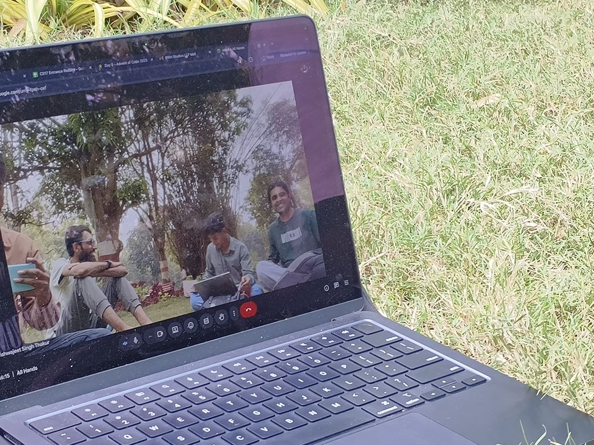

We decided to consolidate our clientele to just three customers, two of them being Frappe and Azim Premji Foundation (with whom we were already doing CS17). This lets us do less context switching and more internal collaboration too. And the saved time could then be used to create content and build products, our forte.

We have also started experimenting with a focus solely on impact organisations for future expansion. We looked back on where we delivered the most value in services, and Frappe-based apps for non-profits was the answer. It made sense too, Frappe + Apps for NPOs is just a solid product-market fit.

### Mentors

Rushabh and Umair have been great mentors to me. Both of them were always a call away. Whenever I felt things were burning down, having a chat with Rushabh always gave me **hope**. Isn't that something we all need in our lives? Hope?

### Current heading

We still operate from Jagdalpur.

We still don't do ERPNext implementations.

What has changed is our direction. We have decided to narrow down our services focus onto NPOs (including APF). For products, we are betting hard on **Commera** (we will soon be launching it) and **Buzz**.

A big chunk of services has again started to depend on me. If we want the products to be a success, I have to personally be involved at this point, because no one else in the team has the needed experience to be 100% independent. For trainings, Rahul has been a helping hand and we continue to provide top-notch trainings for Frappe Framework.

As with a lot of companies right now, we are trying to figure things out: AI agents, GTM for products, trainings, and more. We are giving our best to the projects we have in our hands right now. Trying to stay afloat.

### The horizon

I personally want to be a content creator / educator most of my work time, but that does not seem to be likely for quite some time. Personally I am waiting for the next set of leaders at BWH, who would help free my bandwidth, so I can do what I am best at, rather than doing what needs to be done to pay the salaries. I am not saying I am not having fun, but I would like to maximise it, for me and for my colleagues.

I have gained a lot of respect for founders who have dared to start a business and have stayed at it for years 🫡

Catch you later!

### BTS Gallery

<Gallery label="Gallery">

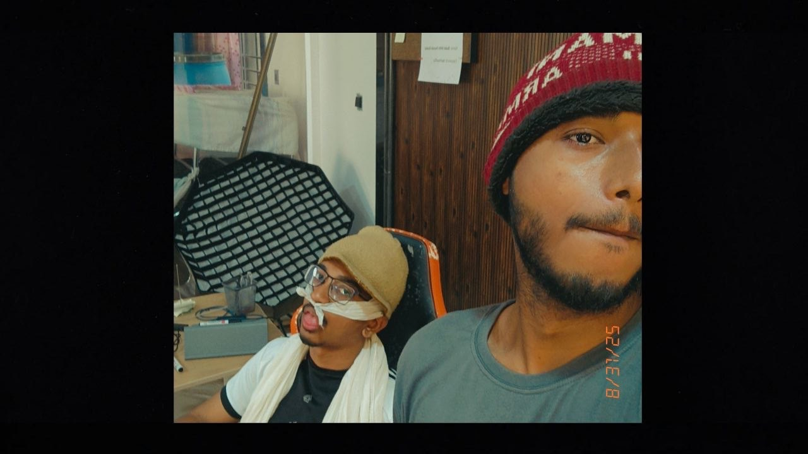

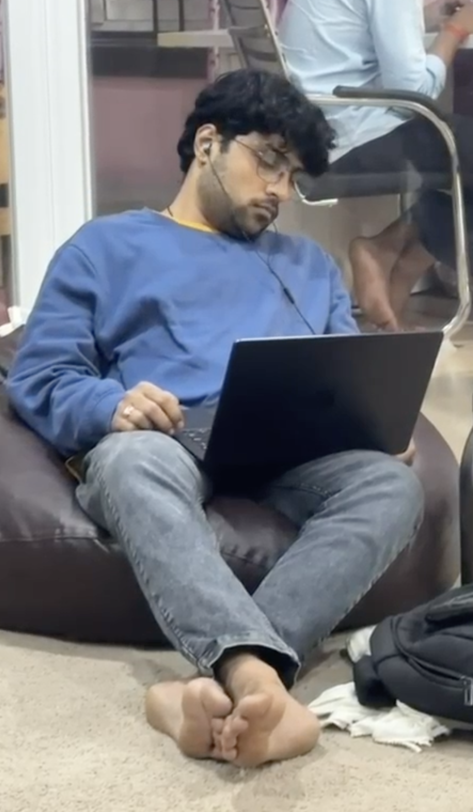

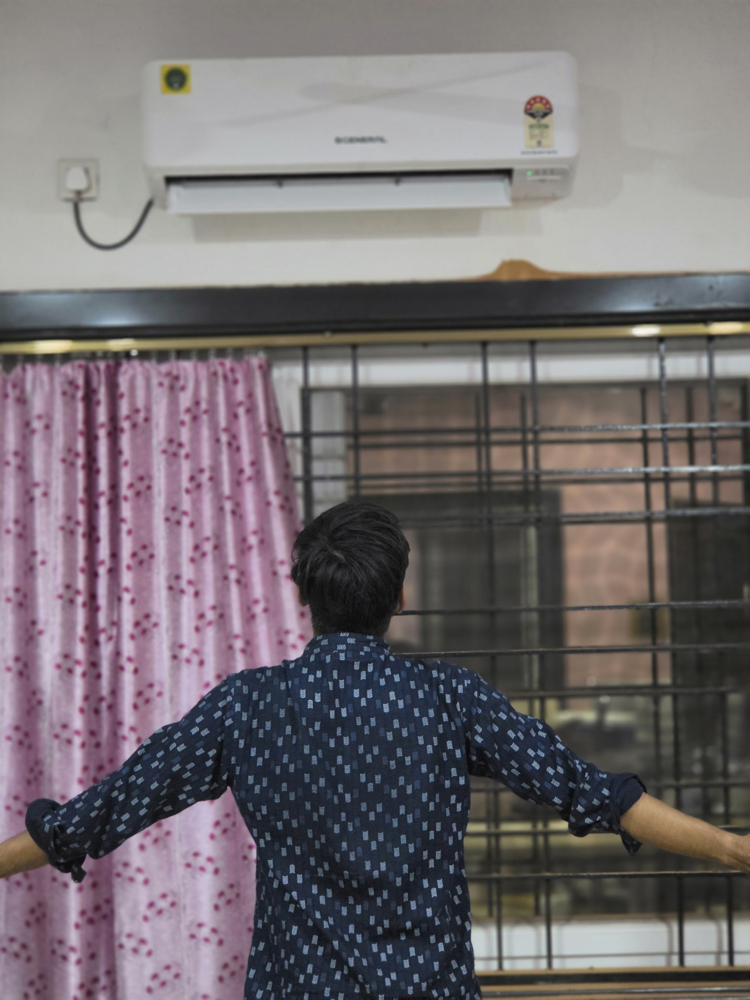

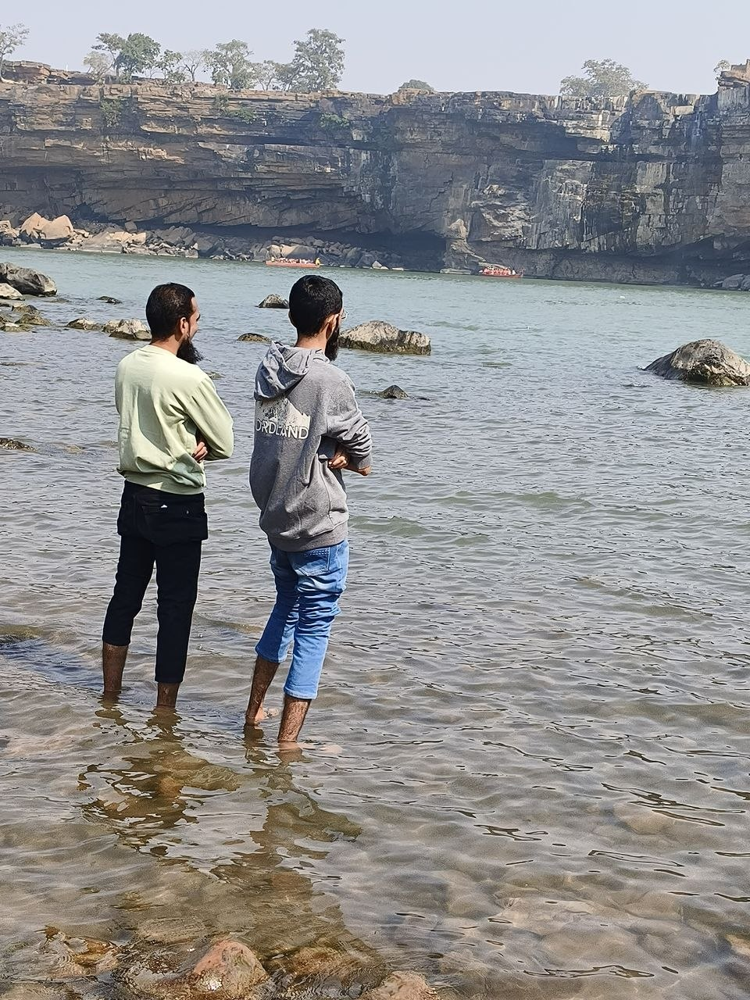

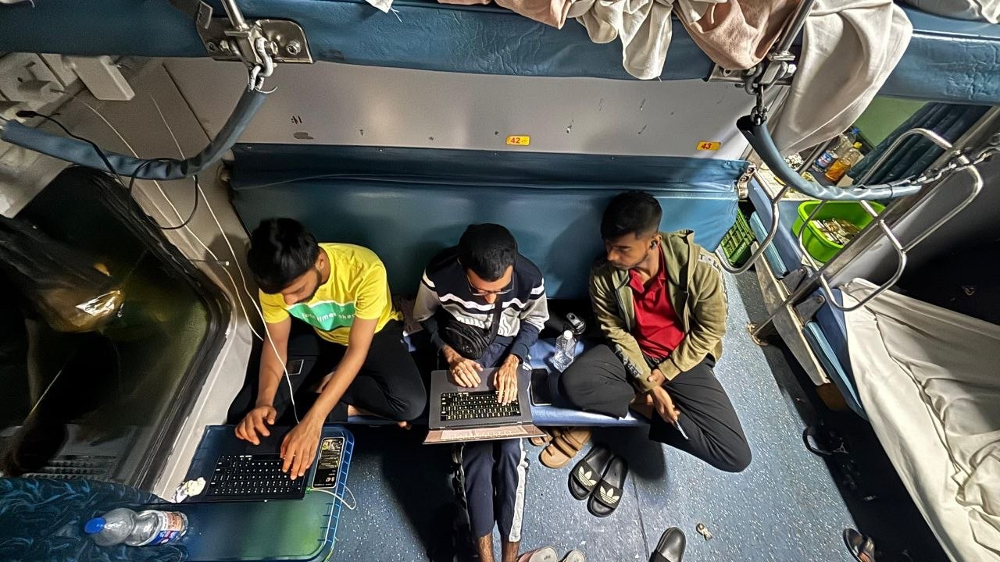

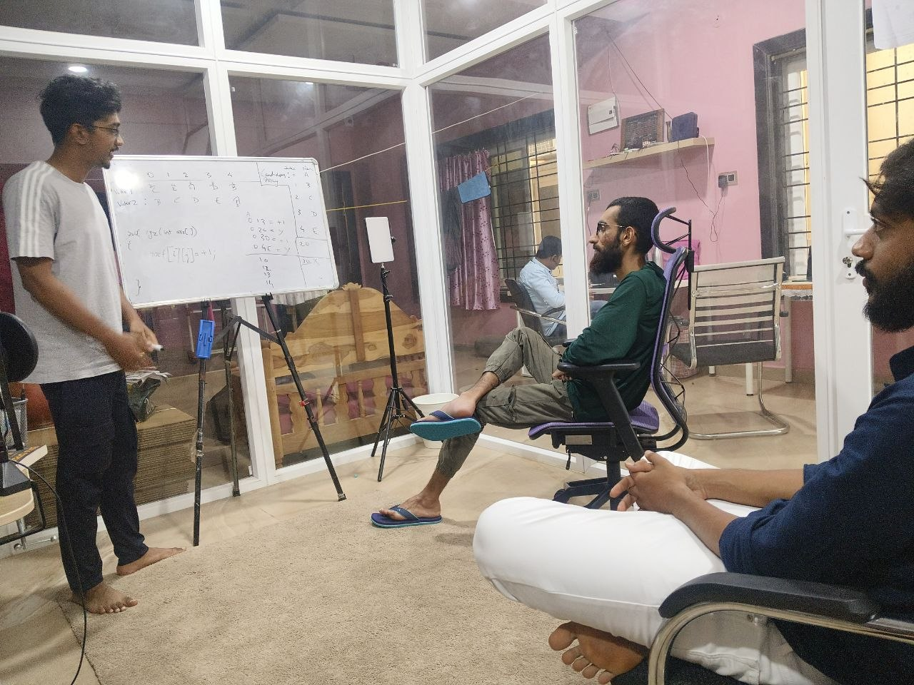

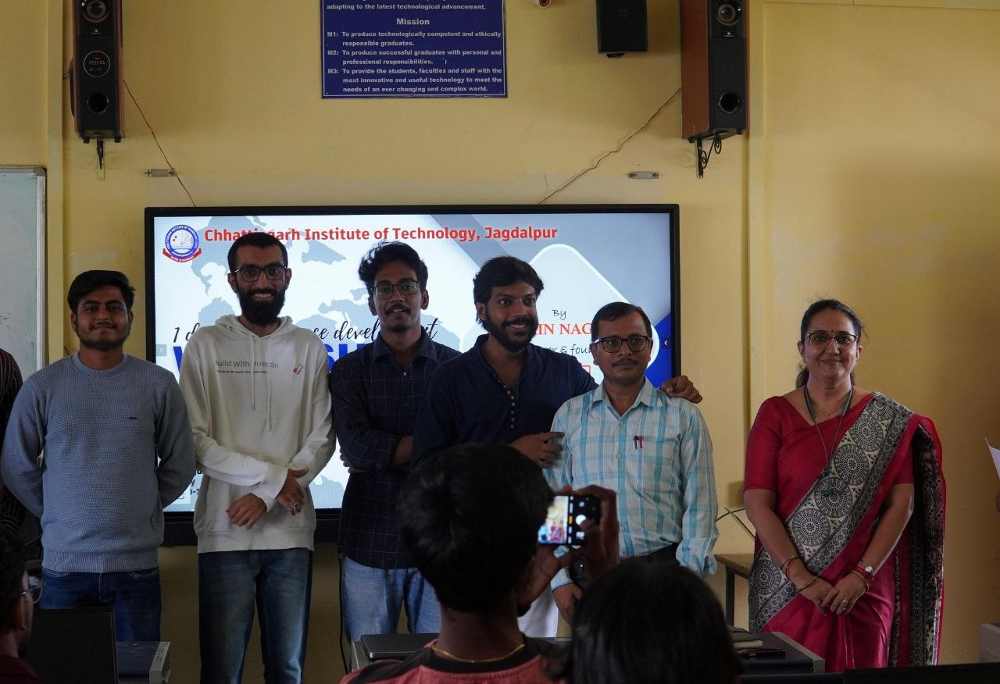

</Gallery>

